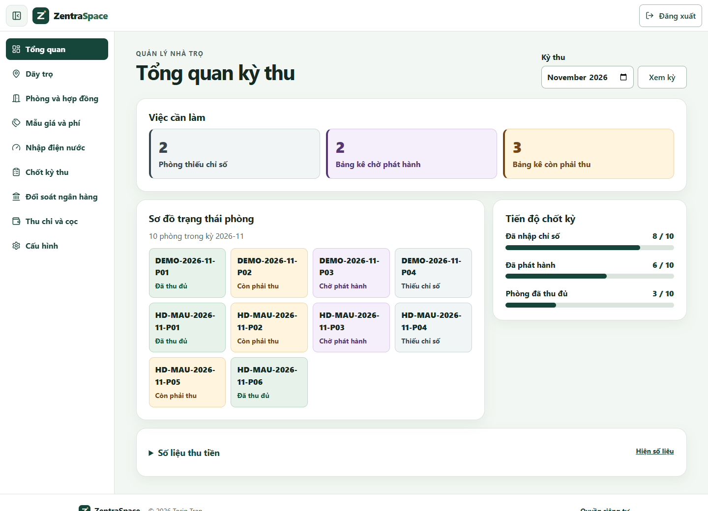
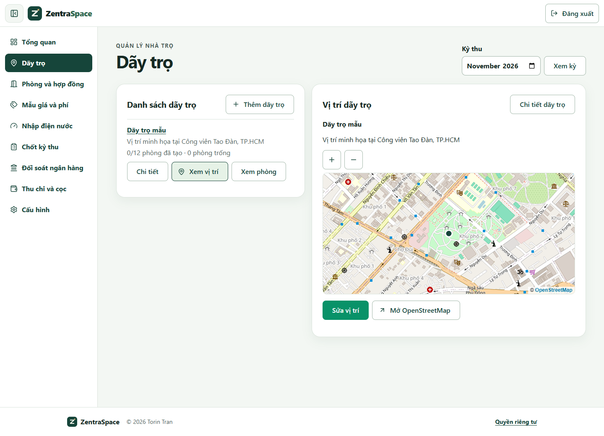
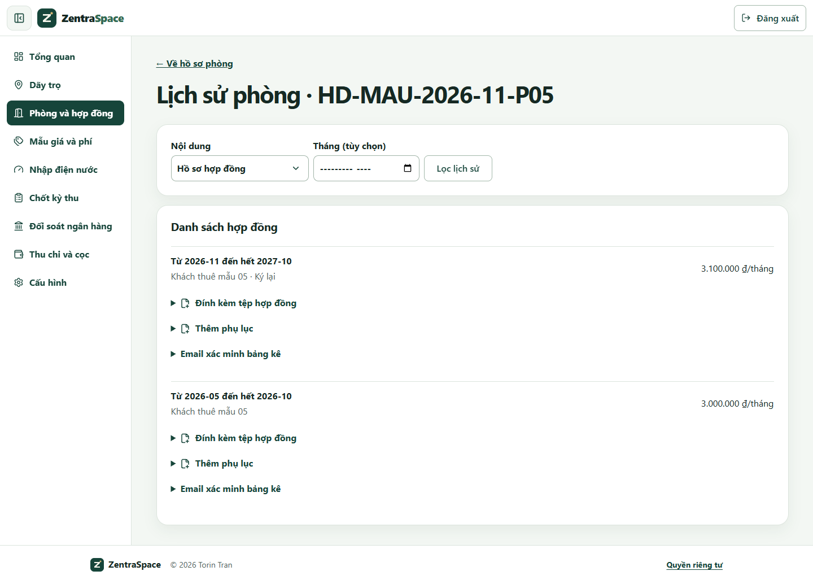
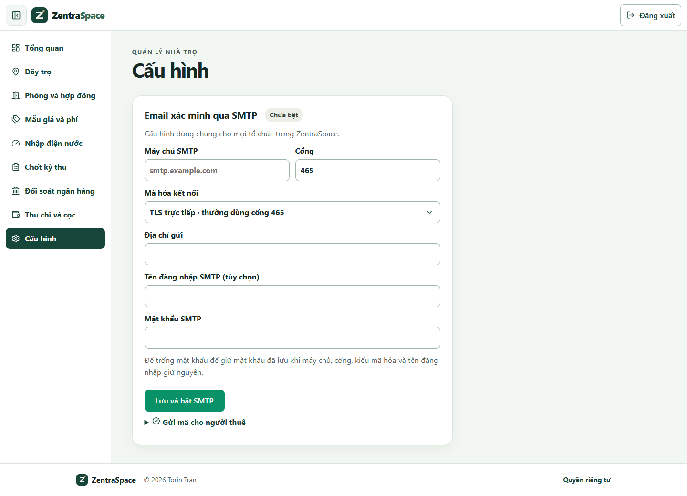

# ZentraSpace

ZentraSpace là ứng dụng quản lý nhiều dãy trọ. Chủ trọ có thể chuẩn bị phòng và phí, tiếp nhận người thuê, lưu hợp đồng, chốt điện nước, chia sẻ bảng kê riêng và theo dõi công nợ.

## Giao diện minh họa

Ảnh chụp từ phiên bản chạy trên Docker với dữ liệu giả lập.



<details>
<summary>Xem bản đồ dãy trọ, lịch sử hợp đồng và cấu hình SMTP</summary>

**Dãy trọ và bản đồ**



**Lịch sử hợp đồng của phòng**



**SMTP dùng chung**



</details>

## Chạy trên Windows với Docker Desktop

1. Tại thư mục dự án, chạy `./scripts/init-local.ps1` để sinh mật khẩu và khóa. Nếu đã có cấu hình, script giữ lại tệp cũ.
2. Chạy `docker compose up --build -d --wait`.
3. Mở [ZentraSpace](http://localhost:8087/). Chọn **Chủ trọ** và dùng giá trị `ZS_OWNER_PASSWORD` trong tệp `.env`. Để thử vai trò **Nhân viên công tơ**, dùng `ZS_METER_PASSWORD`.

Màn đăng nhập có hai lựa chọn mặc định **Chủ trọ** và **Nhân viên công tơ**. Chọn **Tài khoản khác** để nhập tên đăng nhập do người quản lý cấp. Có thể cấp thêm tài khoản qua biến `ZS_STAFF_ACCOUNTS` chứa mảng JSON với các trường `Username`, `Organization`, `Role` và `Password`. Mỗi tài khoản gắn với một tổ chức và vai trò `owner` hoặc `meter`. Tổ chức khác có sổ phòng, công nợ và tài khoản ngân hàng riêng.

Chủ trọ vào **Cấu hình → Nhân viên công tơ** để tạo tài khoản và chọn một hoặc nhiều dãy được giao. Nhân viên đăng nhập bằng tên đầy đủ dạng `ma-to-chuc/ten-tai-khoan` hiển thị trên màn cấu hình. Hệ thống thu hồi phiên cũ khi đổi phạm vi, đặt lại mật khẩu hoặc tắt tài khoản. Chủ trọ xem được các thay đổi gần đây.

Để nạp dữ liệu giả lập cho kỳ 11/2026, chạy `docker compose exec web zentraspace seed-demo 2026-11` rồi mở **Tổng quan** và chọn kỳ đó. Bốn phòng `DEMO-` lần lượt có bảng kê đã thu đủ, đã thu một phần, đang nháp và chưa nhập công tơ. Chạy lại cùng kỳ giữ nguyên các phòng demo đã tạo. Lệnh nạp chỉ chạy ở chế độ HTTP cục bộ.

Lệnh `docker compose exec web zentraspace seed-lease-demo 2026-11` bổ sung sáu phòng `HD-MAU-` với giá thuê và chỉ số giả lập, hợp đồng 6, 12 và 18 tháng, hai phòng ký lại, cùng bảng kê nhiều kỳ. Chạy lại cùng kỳ giữ nguyên dữ liệu demo đã tạo.

Chọn kỳ thu ở đầu màn hình. Vào **Phòng và hợp đồng** để nhập một phòng hoặc tải tệp CSV/XLSX theo mẫu. Có thể chọn dãy đích và xem kết quả kiểm tra trước khi lưu. Tệp XLSX dùng một trang tính, tối đa 150 dòng phòng và chỉ nhận giá trị đã điền. Sang **Nhập điện nước** để ghi chỉ số cuối kỳ, sau đó vào **Chốt kỳ thu** để tạo bản nháp. Mở từng bảng kê, kiểm tiền và phát hành. Thao tác thu thiếu, thu dư, hoàn và ghi giảm đều có lịch sử. CSV công nợ tải được từ màn chốt kỳ.

Trên máy tính, bấm nút cạnh logo ZentraSpace ở góc trên bên trái để thu gọn hoặc mở rộng thanh bên. Chế độ thu gọn chỉ hiện biểu tượng. Trình duyệt ghi nhớ lựa chọn khi bạn chuyển trang hoặc tải lại. Trên điện thoại, bấm **Menu quản lý** để mở hoặc đóng danh sách.

Tạo **Dãy trọ** bằng tên, địa chỉ và số phòng tối đa. Mở **Chọn vị trí trên bản đồ** để ghim trực tiếp hoặc bấm **Dùng vị trí hiện tại** và cấp quyền cho trình duyệt. Sau khi lưu, **Xem vị trí** hiển thị bản đồ trong ứng dụng. **Sửa vị trí** mở bản đồ với điểm đã lưu hoặc cho phép ghim điểm đầu tiên. Có thể nhập tọa độ thủ công hoặc dùng phím mũi tên dịch bản đồ và bấm **Ghim tâm**. Chọn **Xem phòng** để tạo hoặc lọc phòng thuộc dãy. [Chính sách sử dụng ô bản đồ OpenStreetMap](https://operations.osmfoundation.org/policies/tiles/)

Mở **Chi tiết** từ danh sách dãy để xem địa chỉ, số phòng đã tạo, số phòng đang thuê và số phòng trống. Chọn **Sửa thông tin** để đổi tên và số phòng tối đa. Chủ trọ có thể chọn **Xóa dãy trọ** ở cuối trang chi tiết sau khi đã chuyển hoặc xóa hết phòng trong dãy. Trong chi tiết phòng, mục **Xóa phòng** áp dụng cho phòng chưa có người thuê, hợp đồng, chỉ số, bảng kê hoặc giao dịch. Khi xác nhận xóa, hệ thống bỏ cả ảnh và các mẫu phí chưa sử dụng của phòng đó.

Tạo **Mẫu giá và phí** để dùng lại tiền thuê, đơn giá điện nước và một khoản phí định kỳ. Khi gán mẫu, phòng nhận một bản sao các mức giá và phí. Phòng đặc biệt có thể nhập giá riêng hoặc thêm khoản thu riêng. Trong hồ sơ phòng, chủ trọ có thể lưu một ảnh JPG hoặc PNG tối đa 2 MB, ghi người ở cùng và ngày vào hoặc rời phòng. Ảnh được mã hóa theo tổ chức. **Lịch sử phòng** tổng hợp hợp đồng, thay đổi người ở, bảng kê, thu tiền và các giao dịch cọc đã ghi.

Hồ sơ chính chỉ hiển thị hợp đồng của kỳ đang xem và tối đa tám hoạt động trong kỳ. Mở **Xem tất cả hợp đồng** để tra cứu hợp đồng và tệp của các kỳ khác, hoặc **Mở lịch sử phòng** để lọc nhật ký theo tháng và loại hoạt động. Mỗi trang lịch sử tải tối đa 12 dòng. Dữ liệu nguồn vẫn nằm trong sổ mã hóa của tổ chức.

Để sửa một khoản thu hoặc ghi giảm nhập sai, mở **Lịch sử giao dịch**, chọn **Đảo bút toán** và nhập lý do. Lịch sử giữ cả hai bút toán và mã tham chiếu chứng từ gốc. Khoản thu đã ghép sao kê cần kiểm tra lại giao dịch ngân hàng trước khi điều chỉnh.

Trong **Chốt kỳ thu**, dùng bộ lọc **Có tiền dư** để tìm bảng kê đã thu vượt số phải trả. Mở mục **Tiền thu dư** trên bảng kê để chuyển số dư sang kỳ sau của cùng hợp đồng hoặc đảo một lần chuyển có lý do. Sổ thu chi ghi tiền ở lần nhận thực tế. CSV công nợ có cột số dư đã chuyển và số dư còn có thể chuyển.

Trong **Mẫu giá và phí**, chọn **Áp dụng mẫu cho nhiều phòng**, chọn dãy hoặc nhóm phòng chưa gán dãy và kỳ hiệu lực. Màn xem trước hiển thị giá và lý do bỏ qua của từng phòng. Khi xác nhận, các phòng đang chuẩn bị nhận bản sao mẫu theo kỳ đã chọn và ghi lần áp dụng vào lịch sử. Hợp đồng đã có và bảng kê đã phát hành giữ nguyên các mức đã ghi.

Trong **Phòng và hợp đồng**, có thể tạo phòng trước và để trống người đại diện, kể cả khi nhập từ CSV. Đặt giá thuê và đơn giá điện nước khi tạo hoặc chỉnh sửa phòng, rồi mở **Giá và phí** để thêm phí riêng định kỳ. Phòng trống xuất hiện trong danh sách phòng và chưa vào hàng chờ nhập công tơ hoặc chốt kỳ thu.

Khi có khách, chọn **Tiếp nhận người thuê** và nhập ngày bắt đầu hiệu lực. Giá mặc định lấy từ hồ sơ phòng. Có thể nhập thời hạn tính theo kỳ tháng, số điện thoại và ngày ký. Sau khi lưu, mở **Hợp đồng** để lưu hợp đồng chính và các phụ lục. Mỗi hợp đồng lưu tối đa 12 tệp PDF, JPG hoặc PNG, mỗi tệp tối đa 8 MB. PostgreSQL lưu cả tệp và tên phụ lục dưới dạng mã hóa. Chỉ chủ trọ thuộc tổ chức của phòng tải được.

Để đổi người đại diện hoặc đơn giá, chọn **Thêm hợp đồng** trong hồ sơ phòng. Khi tiếp nhận giữa tháng, tiền thuê kỳ đầu tính theo số ngày từ ngày bàn giao, còn điện nước tính từ chỉ số tại thời điểm bàn giao. Khi trả trong cùng tháng, tiền thuê tính đến hết ngày trả. Bản hiện tại hỗ trợ một hợp đồng cho mỗi phòng trong một kỳ tháng. Bảng kê đã phát hành giữ nguyên nội dung.

Trong **Phòng và hợp đồng**, mục **Hợp đồng sắp hết hạn** hiển thị các hợp đồng kết thúc trong 60 ngày tới. Chọn **Ký lại** để mở form với kỳ hiệu lực tiếp theo. Hợp đồng đã trả phòng hoặc đã có hợp đồng tiếp nối sẽ được bỏ qua.

Ghi chỉ số bàn giao cuối kỳ ở **Nhập điện nước**, sau đó mở **Trả phòng và tất toán** từ hồ sơ phòng. Ngày trả mặc định là hôm nay theo giờ Việt Nam. Xem chỉ số và các khoản tiền rồi xác nhận số cọc thực hoàn hoặc cấn vào bảng kê cuối. Bảng kê cuối chưa phát hành tính tiền thuê theo số ngày từ đầu kỳ tới hết ngày trả. Bảng kê đã phát hành giữ nguyên. Sổ thu chi ghi cấn cọc riêng với dòng tiền. Danh sách phòng và dãy cập nhật trạng thái trống ngay sau xác nhận. Hợp đồng mới có thể bắt đầu từ kỳ kế tiếp và lịch sử vẫn tra cứu được.

Phòng không có hợp đồng hiệu lực được bỏ khỏi hàng chờ chốt chỉ số. Nếu cho thuê lại sau một kỳ trống, Chủ trọ nhập số lúc bàn giao và số cuối kỳ trong **Nhập điện nước**. Nếu thay công tơ điện hoặc nước giữa kỳ, ghi số cuối công tơ cũ, số đầu công tơ mới, số cuối kỳ và lý do. Bảng kê cho thấy sản lượng của hai đoạn cộng lại. Lý do lưu trong màn quản lý và chỉ số đã phát hành được khóa.

Nếu dãy có công tơ tổng, mở **Nhập điện nước → Đối chiếu công tơ tổng** để ghi mã và chỉ số đầu/cuối kỳ. Khi chênh lệch hoặc còn thiếu chỉ số phòng, luồng chốt kỳ tạm giữ bảng kê của dãy đó. Chủ trọ nhập đủ dữ liệu và xác nhận lý do chênh lệch để tiếp tục. Hệ thống lưu người duyệt và áp tiền điện nước theo chỉ số riêng của từng phòng.

Trong **Chốt kỳ thu**, mở **Hạn thanh toán và phí chung** để đặt hạn thu và một khoản phí chung cho từng phòng. Bảng kê hiển thị khoản phí thành dòng riêng. Thay đổi chỉ áp dụng cho bảng kê chưa phát hành. Khi thu tiền, chọn tiền mặt hoặc chuyển khoản và nhập mã chứng từ nếu có.

Để thêm Wi‑Fi, phụ thu hoặc khoản thu riêng, mở **Xem chi tiết phòng → Phí riêng của phòng**. Chọn thu một lần hoặc hằng tháng và kỳ bắt đầu. Có thể dừng phí hằng tháng từ một kỳ chưa phát hành. Người thuê thấy từng khoản, số đã thu, số còn lại và VietQR trong trang bảng kê sau xác minh.

Mở **Thu chi và cọc** để ghi chi theo danh mục, nhận hoặc hoàn cọc theo phòng và xuất sổ CSV theo tháng giao dịch. Báo cáo tách thu bảng kê, chi phí, cọc nhận, cọc hoàn và số cọc giữ cuối kỳ. Chủ trọ có thể đính kèm PDF, JPG hoặc PNG tối đa 2 MB vào khoản chi hoặc giao dịch cọc. Tệp được lưu mã hóa và chỉ tài khoản chủ trọ cùng tổ chức tải được.

Để thử chia sẻ, tạo link trên bảng kê đã phát hành. Mở link bằng một phiên trình duyệt riêng trên cùng máy và nhập mã dùng một lần. Trong bản chạy thử, chủ trọ trao mã thủ công qua kênh đã xác nhận với người thuê. Lời nhắc được sao chép không chứa mã hoặc số tiền. Có thể thu hồi link ngay cả khi người thuê đang có phiên xem.

Đăng nhập bằng tài khoản `owner` mặc định rồi mở **Cấu hình → Email xác minh qua SMTP**. Điền máy chủ, cổng, kiểu TLS, địa chỉ gửi và thông tin đăng nhập nếu cần. Chọn **Lưu và bật SMTP** rồi dùng **Kiểm tra kết nối đã lưu**. Cấu hình dùng chung cho các tổ chức, có hiệu lực ngay và được mã hóa trong PostgreSQL. Các chủ trọ khác thấy trạng thái bật hoặc tắt. SMTP chỉnh từ giao diện kết nối tới địa chỉ công khai, hoặc máy chủ và cổng đã được khai báo trong `ZS_SMTP_ADDRESS`. Cấu hình `ZS_SMTP_*` trong `.env` vẫn dùng làm mặc định khi chưa có cấu hình được lưu từ giao diện.

Lưu địa chỉ người nhận tại **Hợp đồng → Email xác minh bảng kê** rồi chọn **Tạo link và gửi mã qua email** trên bảng kê. Email chỉ chứa mã xác minh. Chủ trọ chia sẻ link riêng qua Zalo hoặc kênh đã thống nhất. Dùng origin HTTPS khi gửi cho người thuê thật.

## VietQR và đối soát sao kê

Khi đặt tài khoản nhận tiền, chọn ngân hàng theo tên. PostgreSQL giữ danh mục tham chiếu được nạp khi chạy migration. Go tự tìm mã định danh và tạo VietQR. Danh mục hiện lấy từ ảnh chụp dữ liệu ngày 27/11/2026. [API danh mục VietQR](https://www.vietqr.io/api-bank)

Chủ trọ mở **Đối soát ngân hàng**, chọn ngân hàng theo tên rồi nhập số tài khoản và tên chủ tài khoản đã kiểm tra. VietQR được tạo ngay trên máy chủ ZentraSpace và chỉ hiện trên bảng kê đã xác minh còn số tiền phải trả. Sau khi ghi thu một phần, mã dùng số tiền còn lại và giữ nguyên nội dung chuyển khoản của bảng kê. Khi đổi ngân hàng hoặc số tài khoản, ứng dụng thu hồi link cũ. Kiểm tên thụ hưởng trên ứng dụng ngân hàng trước khi xác nhận bất kỳ chuyển khoản thật nào. [Chuyển nhanh qua VietQR của NAPAS](https://napas.com.vn/dich-vu-chuyen-tien-nhanh-napas-247)

Để đối soát, dán các giao dịch tiền vào của tài khoản đang chọn theo mẫu `ma_giao_dich,ngay,so_tien,noi_dung`. Ngày theo YYYY-MM-DD, số tiền VND nguyên dương và mã lấy từ sao kê ngân hàng. Khi nội dung có một mã bảng kê xác định, hệ thống chỉ gợi ý phòng và kỳ. Chủ trọ kiểm rồi chọn ghi khoản thu mới hoặc ghép với khoản thu cùng số tiền đã ghi. Nhập lại và duyệt lại cùng giao dịch giữ nguyên công nợ. Sao kê, tài khoản và liên kết đối soát được lưu trong sổ mã hóa hiện có.

### Môi trường ngân hàng mô phỏng

Chạy `./scripts/start-bank-demo.ps1` để dựng project Docker riêng. Mở ZentraSpace ở cổng **8092** và ngân hàng mô phỏng ở cổng **8093**. Đăng nhập bằng `owner` với mật khẩu local. Dữ liệu sandbox gồm bảng kê mẫu và tài khoản giả `0000000000000`.

Mở bảng kê phòng **DEMO-2026-11-P02**, sao chép mã đối soát và dùng nó làm nội dung chuyển khoản trên mock. Gửi một phần rồi duyệt trong **Đối soát ngân hàng** để thấy công nợ và QR thay đổi. Gửi lại cùng mã giao dịch để kiểm chống ghi trùng. Có thể bật **Tự đối soát mô phỏng** và gửi đúng số còn nợ để thử ghi thu tự động. Giao dịch thiếu mã hoặc mơ hồ vẫn chờ duyệt.

Webhook mô phỏng xác minh HMAC và thời gian gửi, ghi theo tài khoản và mã giao dịch, phản hồi sau khi lưu thành công. Contract kiểm thử là của ZentraSpace. SePay và payOS là tài liệu tham chiếu cho cách xác thực và gửi lại webhook. [SePay Webhooks](https://docs.sepay.vn/tich-hop-webhooks.html) · [Chữ ký payOS](https://payos.vn/docs/tich-hop-webhook/kiem-tra-du-lieu-voi-signature/)

## Phạm vi của lần chạy thử

- Giao diện dùng Next.js App Router, TypeScript, Mantine và Lucide React. Docker Compose dựng frontend riêng trên Node.js, chỉ mở cổng Go ra trình duyệt. Go xác thực, phân quyền, xử lý form và chuyển dữ liệu đã chọn theo màn hình đến frontend để dựng HTML. PostgreSQL lưu dữ liệu nghiệp vụ đã mã hoá. [Quyết định frontend](docs/decisions/001-frontend-stack.md)
- Sổ thử được lưu thành tài liệu mã hóa AES-256-GCM theo phạm vi tổ chức. Transaction khóa hàng khi thay đổi để giữ bất biến tài chính. PostgreSQL RLS giới hạn theo ngữ cảnh giao dịch, tài khoản DB chạy web không sở hữu bảng. Service migration giữ tài khoản bootstrap riêng. Mật khẩu đăng nhập được xác minh bằng bcrypt.
- Mỗi tổ chức có thể quản lý nhiều dãy trọ với hai vai trò chủ trọ và nhân viên công tơ. Dữ liệu lưu trong sổ mã hóa theo tổ chức. Phân quyền theo từng dãy, quản lý vòng đời khóa và nhật ký truy cập hỗ trợ thuộc các bước tiếp theo. Phiên đăng nhập và phiên xem link được tạo lại sau khi khởi động lại web.
- Điện/nước dùng đơn giá đã được người quản lý xác nhận, chưa tự chọn biểu giá pháp lý. VietQR thử nghiệm và đối soát từ CSV dùng dữ liệu do chủ trọ cung cấp. Kết nối SMTP cần cấu hình và nghiệm thu với nhà cung cấp thực tế. Webhook ngân hàng và gửi Zalo tự động vẫn thuộc phạm vi sau.
- Compose mẫu chỉ mở trên loopback để thử bằng dữ liệu mẫu. Trước pilot có người thuê cần môi trường HTTPS, chọn kênh xác minh đã đăng ký, quản lý khóa và backup tách biệt, kiểm tra trên thiết bị thật và tổ chức hai kỳ đối chiếu. Tệp `.env` chứa riêng khóa và thông tin đăng nhập của máy này.

## Kiểm tra lại

Mã ứng dụng nằm trong hai thư mục:

- `frontend/` chứa Next.js, màn hình nghiệp vụ, bố cục và thanh điều hướng.
- `backend/` chứa Go module. Điểm vào nằm ở `cmd/zentraspace/`. Các tệp trong `internal/app/` chia theo khởi động, HTTP, phiên đăng nhập, phòng và hợp đồng, bảng kê, công tơ, thu chi, ngân hàng và lưu trữ.

Dockerfile chạy test Go khi build. Từ thư mục dự án, chạy bộ kiểm tra dùng trong CI với Docker Compose và PowerShell 7.3 trở lên:

```powershell
./scripts/check-local.ps1
```

Để chạy thêm luồng Playwright, dùng Node.js 20 trở lên, chạy `npm ci --prefix tests/browser`, rồi chạy `npx playwright install chromium` trong `tests/browser` và gọi `./scripts/check-local.ps1 -Browser` ở thư mục dự án. Có thể đặt `ZS_BROWSER_CHANNEL=chrome` để dùng Chrome đã cài.

Bộ kiểm tra tự sinh thông tin đăng nhập, dựng project Compose riêng trên cổng 8088, chạy hai bộ smoke test, kiểm cô lập tổ chức ở PostgreSQL và khôi phục bản dump sang cơ sở dữ liệu thứ hai. Sau khi chạy, script dọn container, volume và tệp cấu hình thử. Nếu cổng 8088 đang dùng, truyền `-Port 8089` hoặc một cổng trống khác.

Smoke test dùng dữ liệu tổng hợp để kiểm quyền công tơ, đối chiếu số tiền, phát hành, thu lặp, nhập/xuất CSV, link chuyển tiếp, mã dùng một lần, thu hồi quyền xem, ảnh QR theo số dư và duyệt sao kê. Kiểm tra khôi phục đối chiếu dữ liệu mã hóa và quyền đọc của vai trò runtime trong DB đã phục hồi. Việc quét bằng app ngân hàng và diễn tập triển khai HTTPS thuộc nghiệm thu pilot.

Xem [blueprint sản phẩm](docs/ZENTRASPACE-BLUEPRINT.md) và [backlog pilot](tasks/todo.md).

## Đóng góp và giấy phép

Đọc [Quy tắc ứng xử](CODE_OF_CONDUCT.md) trước khi tham gia. Báo vấn đề về dữ liệu hoặc quyền truy cập theo [chính sách bảo mật](SECURITY.md).

Copyright 2026 Torin Tran. ZentraSpace được phát hành theo [Apache License 2.0](LICENSE).
